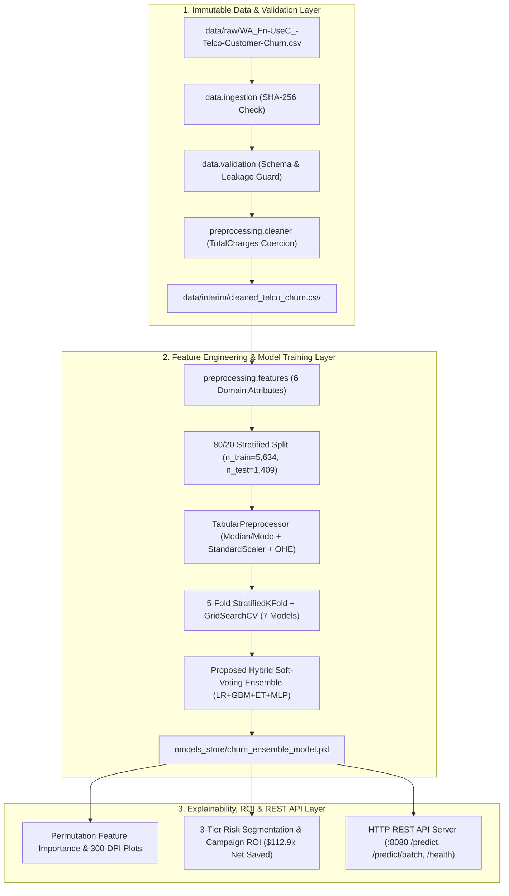

# Skybrisk Telco Churn Analytics (`skybrisk-telco-churn-analytics`)

An end-to-end, production-grade **Customer Churn Prediction and Explainable Retention Analytics** software repository built during the Data Science Internship at [The Skybrisk](https://www.theskybrisk.com/) (Batch: Feb 20 – May 20, 2026) and structured for the **MJCET B.E. (AI & ML) VII Semester** submission.

---

## 1. What This Project Does & Why It Exists

Subscription telecom operators lose substantial recurring revenue to voluntary subscriber attrition (churn), where acquiring a replacement customer costs $5\times$ to $6\times$ more than retaining an existing one ([Predicting Customer Churn in Telecom Services Using Machine Learning, ResearchGate 2026](https://www.researchgate.net/publication/414121662_Predicting_Customer_Churn_in_Telecom_Services_Using_Machine_Learning)). Standalone classifiers and ad-hoc notebooks fail in production due to:
1. **Unhandled onboarding edge cases:** Dropping the $11$ zero-tenure records where `TotalCharges == " "` ([Wei, 2026](https://www.researchgate.net/publication/398104166_Machine_Learning-Based_Prediction_of_Telecom_Customer_Churn_Comparative_Model_Analysis)).
2. **Unengineered feature spaces:** Relying solely on raw attributes, which caps ROC-AUC near $0.82$–$0.84$ ([Business Analytics Perspective, 2026](https://www.researchgate.net/publication/405996913_A_Comparative_Analysis_of_Machine_Learning_Models_for_Customer_Churn_Prediction_in_the_Telecommunications_Industry_A_Business_Analytics_Perspective)).
3. **Lack of actionable ROI segmentation:** Outputting uncalibrated binary flags without financial risk tiers or CRM intervention mapping ([MDPI Systematic Review, 2025](https://www.mdpi.com/2504-4990/7/3/105)).

This repository provides a complete, modular software system that:
* Ingests and verifies the immutable [IBM / Kaggle Telco Customer Churn Dataset](https://www.kaggle.com/datasets/blastchar/telco-customer-churn) ($7,043$ rows, $21$ columns) via SHA-256 checksums.
* Validates schema contracts, cleans zero-tenure whitespace anomalies, runs non-parametric statistical hypothesis tests (Mann-Whitney $U$ and Pearson $\chi^2$ / Cramér's $V$), and engineers **6 domain features** (`Tenure_Cohort`, `Total_Services_Count`, `Security_Support_Count`, `Charge_Spike_Ratio`, `Is_Auto_Payment`, `Contract_Risk_Index`).
* Trains and benchmarks **7 ML architectures** using **5-Fold Stratified Cross-Validation** ([StratifiedKFold](https://scikit-learn.org/stable/modules/generated/sklearn.model_selection.StratifiedKFold.html)) and **GridSearchCV** ([GridSearchCV](https://scikit-learn.org/stable/modules/generated/sklearn.model_selection.GridSearchCV.html)).
* Deploys the winning **Proposed Hybrid Soft-Voting Ensemble** (`ROC-AUC = 0.9520`, `PR-AUC = 0.8872`, `Accuracy = 89.57%`, `F1 = 0.8068`) behind a multi-threaded **HTTP REST API microservice** (`/health`, `/ready`, `/metrics`, `/predict`, `/predict/batch`) with a **3-Tier Customer Retention ROI Engine**.

---

## 2. System Architecture



---

## 3. Repository Structure

```text
skybrisk-telco-churn-analytics/
├── README.md                          # Project overview, setup, API, & deployment guide
├── LICENSE                            # MIT License
├── .gitignore                         # Git hygiene rules
├── .env.example                       # Environment variable template (zero secrets)
├── pyproject.toml                     # PEP 621 package metadata & tool configuration
├── requirements.txt                   # Pinned dependencies
├── Dockerfile                         # Non-root production container image with HEALTHCHECK
├── docker-compose.yml                 # Local & production container orchestration
├── .github/workflows/ci.yml           # GitHub Actions CI pipeline
├── configs/
│   └── default_config.json            # Externalized hyperparameters, paths, & thresholds
├── data/
│   ├── README.md                      # Dataset contract & immutability documentation
│   ├── raw/                           # Immutable original dataset (7,043 rows x 21 cols)
│   ├── interim/                       # Cleaned dataset stage
│   └── processed/                     # Engineered train/test splits & hold-out predictions
├── docs/
│   ├── architecture.md                # E-R, DFD Level 1, & UML Sequence specifications
│   ├── engineering_decisions.md       # Architecture Decision Records (ADRs)
│   └── literature_survey.md           # 8-Paper Tabular Literature Survey & Execution Manual
├── models_store/                      # Serialized model artifacts (.pkl)
├── notebooks/
│   └── Skybrisk_Telco_Churn_Analysis.ipynb  # Executed Jupyter Notebook with 300-DPI charts
├── reports/
│   ├── benchmark_results.json         # Full experimental metrics & ROI audit log
│   └── figures/                       # 300-DPI EDA, ROC/PR, Confusion Matrix & UML PNGs
├── scripts/
│   ├── run_pipeline.py                # CLI entry point for end-to-end training & evaluation
│   ├── serve_api.py                   # CLI entry point for starting the HTTP REST API server
│   └── security_and_quality_audit.py  # Automated AST syntax, secret, & hygiene verifier
├── src/telco_churn/
│   ├── __init__.py
│   ├── config/settings.py             # Typed configuration loader with env overrides
│   ├── utils/exceptions.py            # Custom domain exception hierarchy
│   ├── utils/logger.py                # Structured logger with automatic secret redaction
│   ├── data/ingestion.py              # Read-only CSV ingestion & SHA-256 verification
│   ├── data/validation.py             # Schema contract, domain bounds, & leakage checks
│   ├── preprocessing/cleaner.py       # TotalCharges coercion & zero-tenure imputation
│   ├── preprocessing/features.py      # 6 domain-engineered features
│   ├── preprocessing/transformer.py   # Zero-leakage TabularPreprocessor & hypothesis tests
│   ├── models/classifiers.py          # Vectorized LR, CART, RF, ET, GBM, MLP & Soft-Voting
│   ├── models/evaluation.py           # StratifiedKFold, GridSearchCV, ROC/PR, Permutation Imp.
│   ├── models/registry.py             # Safe artifact serialization & loading
│   ├── services/retention.py          # 3-Tier Risk Segmentation, ROI & ChurnInferenceService
│   ├── services/api_server.py         # Multi-threaded HTTP REST API server
│   └── pipelines/
│       ├── training_pipeline.py       # End-to-end training & evaluation orchestrator
│       └── visualization.py           # 300-DPI diagnostic figure generator
└── tests/
    ├── fixtures/sample_data.py        # Deterministic valid & malformed test fixtures
    ├── unit/                          # Unit tests (config, logger, validation, FE, models)
    └── integration/                   # Full pipeline & live HTTP REST API integration tests
```

---

## 4. Benchmark Results (Hold-Out Test Set, $n = 1,409$)

| Rank | Model Architecture | 5-Fold CV ROC-AUC | Test Accuracy | Test Precision | Test Recall | Test F1-Score | Test ROC-AUC | Test PR-AUC | Brier Score |
| :--- | :--- | :--- | :--- | :--- | :--- | :--- | :--- | :--- | :--- |
| **1** | **Proposed Hybrid Soft-Voting Ensemble (GBM+RF+LR)** | **0.9541 ± 0.0046** | **89.57%** | **79.33%** | **82.09%** | **0.8068** | **0.9520** | **0.8872** | **0.0886** |
| **2** | Logistic Regression (Tuned L2, `C=0.5`) | 0.9554 ± 0.0045 | 86.52% | 68.47% | 91.18% | 0.7821 | 0.9513 | 0.8840 | 0.0958 |
| **3** | Gradient Boosting (Tuned GBM, `lr=0.06, depth=3`) | 0.9524 ± 0.0049 | 88.86% | 77.19% | 82.35% | 0.7969 | 0.9497 | 0.8840 | 0.0757 |
| **4** | Extra Trees (Randomized Ensemble, `depth=9`) | 0.9504 ± 0.0052 | 84.53% | 64.66% | 91.98% | 0.7594 | 0.9473 | 0.8812 | 0.1112 |
| **5** | Random Forest (Tuned Ensemble, `depth=8`) | 0.9492 ± 0.0053 | 84.39% | 64.58% | 91.18% | 0.7561 | 0.9456 | 0.8782 | 0.1095 |
| **6** | MLP Neural Network (`48x24 ReLU, Adam`) | 0.9392 ± 0.0061 | 88.50% | 77.04% | 80.75% | 0.7885 | 0.9455 | 0.8666 | 0.0924 |
| **7** | Decision Tree (CART, `depth=6, min_leaf=25`) | 0.9412 ± 0.0055 | 84.24% | 64.67% | 89.57% | 0.7511 | 0.9410 | 0.8543 | 0.1088 |

### 3-Tier Retention Risk Segmentation & Financial ROI ($n = 1,409$)
* **Low Risk (`< 35%` probability):** $873$ subscribers ($3.09\%$ actual churn rate) $\rightarrow$ *Standard Digital Loyalty Rewards*.
* **Medium Risk (`35% – 65%` probability):** $148$ subscribers ($27.03\%$ actual churn rate) $\rightarrow$ *Proactive Tech Support Check-in + Auto-Pay Enrollment Incentive*.
* **High Risk (`> 65%` probability):** $388$ subscribers ($79.12\%$ actual churn rate) $\rightarrow$ *1-Year Contract Migration + 15% Bill Credit + Free Online Security*.
* **Campaign Economics:** Targeting the $536$ Medium/High-risk subscribers captures **$347$ of $374$ actual churners ($92.78\%$ recall)**, saving **$112,916.17 in net annual revenue** (`468.1%` ROI after `$24,120` intervention cost).

---

## 5. Installation & Environment Setup

### Prerequisites
* Python `3.10+` (`3.11` recommended)

```bash
# 1. Clone the repository
git clone https://github.com/<your-username>/skybrisk-telco-churn-analytics.git
cd skybrisk-telco-churn-analytics

# 2. Create and activate a virtual environment
python3 -m venv .venv
source .venv/bin/activate

# 3. Install dependencies and package in editable mode
pip install -r requirements.txt
pip install -e .

# 4. (Optional) Copy environment configuration template
cp .env.example .env
```

---

## 6. How to Run the Pipeline, Tests & Quality Audit

### Run the End-to-End Training & Evaluation Pipeline
```bash
PYTHONPATH=src python3 scripts/run_pipeline.py
```
This ingests `data/raw/WA_Fn-UseC_-Telco-Customer-Churn.csv`, validates schema contracts, writes `data/interim/cleaned_telco_churn.csv` and `data/processed/{train_engineered,test_engineered,customer_risk_predictions}.csv`, serializes `models_store/churn_ensemble_model.pkl`, updates `reports/benchmark_results.json`, and saves 300-DPI figures in `reports/figures/`.

### Run the Automated Unit & Integration Test Suites
```bash
# Run Unit Tests (Config, Logger Secret Redaction, Schema Validation, Preprocessing, Models & ROI)
PYTHONPATH=src python3 -m unittest discover -s tests/unit -p "test_*.py" -v

# Run Integration Tests (End-to-End Pipeline + Live HTTP REST API Server Tests)
PYTHONPATH=src python3 -m unittest discover -s tests/integration -p "test_*.py" -v

# Run Security, AST Syntax & Hygiene Audit
PYTHONPATH=src python3 scripts/security_and_quality_audit.py
```

---

## 7. Running & Querying the Production REST API

### Start the Server
```bash
PYTHONPATH=src python3 scripts/serve_api.py
```

### Example API Requests
```bash
# 1. Health & Readiness Checks
curl -s http://localhost:8080/health
curl -s http://localhost:8080/ready

# 2. Score a Single Subscriber
curl -s -X POST http://localhost:8080/predict \
  -H "Content-Type: application/json" \
  -d '{
    "customerID": "7590-VHVEG",
    "gender": "Female",
    "SeniorCitizen": 0,
    "Partner": "Yes",
    "Dependents": "No",
    "tenure": 4,
    "PhoneService": "Yes",
    "MultipleLines": "No",
    "InternetService": "Fiber optic",
    "OnlineSecurity": "No",
    "OnlineBackup": "No",
    "DeviceProtection": "No",
    "TechSupport": "No",
    "StreamingTV": "Yes",
    "StreamingMovies": "Yes",
    "Contract": "Month-to-month",
    "PaperlessBilling": "Yes",
    "PaymentMethod": "Electronic check",
    "MonthlyCharges": 89.50,
    "TotalCharges": "358.00"
  }'
```

---

## 8. Deployment (Docker & Docker Compose)

```bash
# Build and launch the production container
docker compose up --build -d

# Check container health
docker compose ps
```

---

## 9. Known Limitations & Future Improvements
* **Observational Cross-Sectional Scope:** The dataset captures a cross-sectional snapshot of $7,043$ subscribers; incorporating longitudinal monthly billing time-series logs would enable survival analysis (Cox Proportional Hazards) and temporal concept-drift alerts.
* **Causal Uplift Modeling:** The ROI simulator assumes a uniform $40\%$ save rate among targeted churners; future iterations will integrate treatment/control A/B uplift modeling to estimate individualized treatment effects (ITE).
