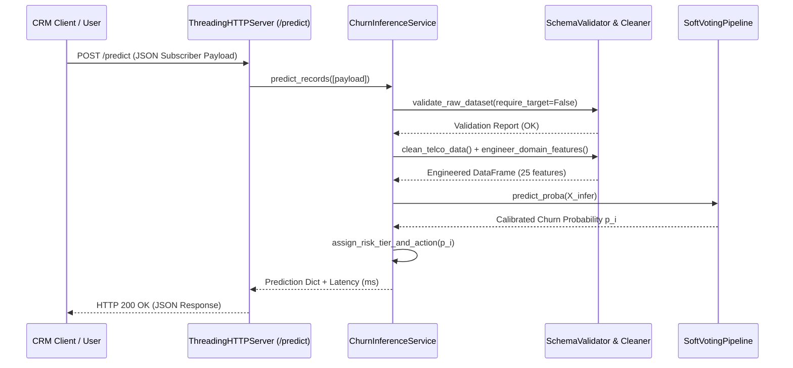

# System Architecture, E-R Schema, DFD & UML Specifications

## 1. High-Level System Architecture (Data Flow Diagram — Level 1)

```mermaid
flowchart LR
    A[Raw CSV Dataset<br/>7,043 rows x 21 cols] --> B[Data Ingestion &<br/>SHA-256 Verifier]
    B --> C[Schema & Domain<br/>Validator]
    C --> D[Immutable Cleaner<br/>TotalCharges Fix]
    D --> E[(Interim CSV<br/>cleaned_telco_churn.csv)]
    E --> F[Feature Engineer<br/>6 Domain Attributes]
    F --> G[80/20 Stratified<br/>Train-Test Split]
    G --> H[TabularPreprocessor<br/>Median/Mode + Scaler + OHE]
    H --> I[5-Fold Stratified CV<br/>& GridSearchCV]
    I --> J[Proposed Hybrid<br/>Soft-Voting Ensemble]
    J --> K[3-Tier Retention ROI<br/>& REST API Service]
```

## 2. Entity-Relationship (E-R) Schema Design
* **`CUSTOMER`** (`PK: customerID`, `gender`, `SeniorCitizen`, `Partner`, `Dependents`, `tenure`) — $1:1$ relationship with `SERVICE_SUBSCRIPTION` and `BILLING_ACCOUNT`.
* **`SERVICE_SUBSCRIPTION`** (`PK: subID`, `FK: customerID`, `PhoneService`, `MultipleLines`, `InternetService`, `OnlineSecurity`, `OnlineBackup`, `DeviceProtection`, `TechSupport`, `StreamingTV`, `StreamingMovies`).
* **`BILLING_ACCOUNT`** (`PK: accountID`, `FK: customerID`, `Contract`, `PaperlessBilling`, `PaymentMethod`, `MonthlyCharges`, `TotalCharges`).
* **`CHURN_PREDICTION_LOG`** (`PK: predID`, `FK: customerID`, `Predicted_Churn_Prob`, `Predicted_Churn_Label`, `Risk_Tier`, `Contract_Risk_Index`, `Annualized_Revenue_At_Risk`, `Recommended_Intervention`) — $1:N$ relationship with `CUSTOMER`.

## 3. UML Sequence Flow (Real-Time REST API Inference)

